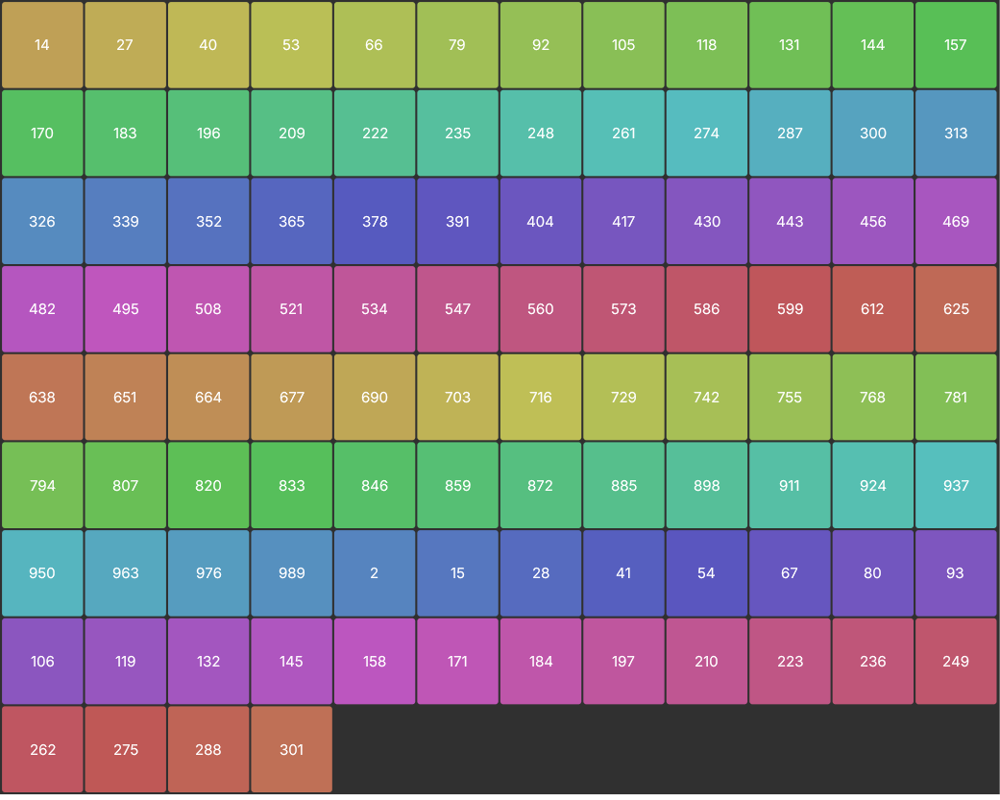
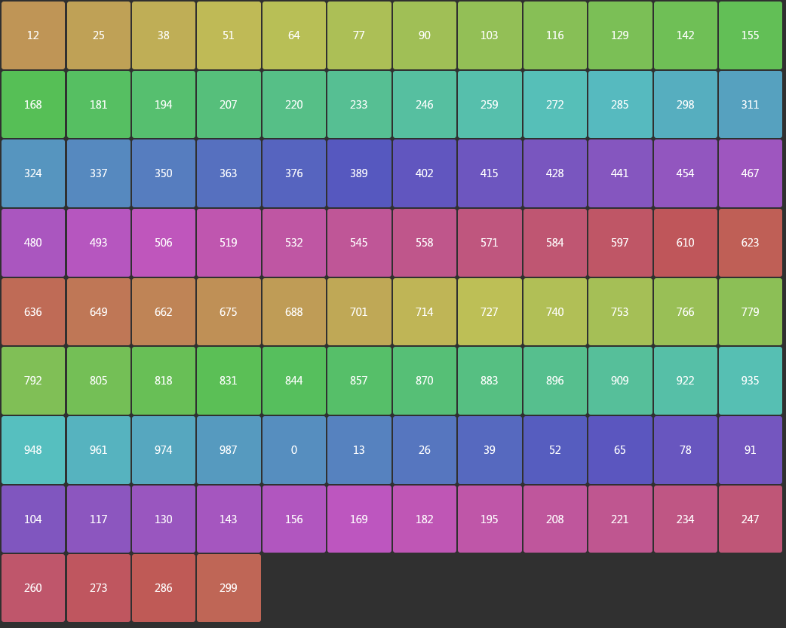
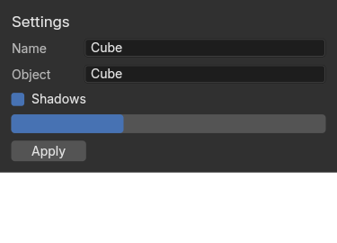
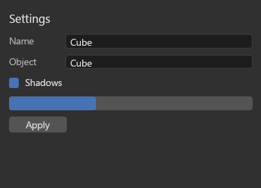

# BUI vs GPUI — the complete comparison

Everything measured, everything learned, and every caveat. This is the long
form; [`README.md`](README.md) is the short version, and [`RESULTS.md`](RESULTS.md)
is the raw generated tables.

| | **BUI** | **GPUI** |
|---|---|---|
| Repository | [ppmpreetham/BUI](https://github.com/ppmpreetham/BUI) | [zed-industries/zed · crates/gpui](https://github.com/zed-industries/zed/tree/main/crates/gpui) |
| Crate measured | `blenderui` **0.5.0** (published 2026-11-08) | `gpui` **0.2.2** (published 2026-10-30) |
| Language | C core (`kit/`, `gpu/`, `core/`) + thin Rust bindings | Rust |
| Origin | Blender's UI toolkit, decoupled from Blender | Zed's editor UI framework |
| Renderer | software raster by default; opt-in GPU (OpenGL 3.3 / D3D 11) | GPU only (Vulkan on Linux, Metal on macOS, D3D/Vulkan on Windows) |
| Layout | HTML/CSS semantics on taffy, gpui-style builders | taffy-based, builder API |
| Widgets | Blender's real widgets: number field, slider, colour picker, pie menu, node editor, file browser | primitives only; you build controls from `div`s |
| Text | FreeType + embedded Inter (Blender's rendering) | cosmic-text |
| Licence | GPL-3.0-or-later | Apache-2.0 (as part of Zed) |

Both expose the same builder syntax (`div().flex().gap_2()`), which is what makes
a controlled comparison possible: **one source file compiles against both**.

---

## 1. Machine and method

### The machine

| | |
|---|---|
| CPU | 11th Gen Intel Core i5-1135G7 @ 2.40 GHz, 4 cores / 8 threads |
| GPU | Intel TigerLake-LP GT2 [Iris Xe Graphics] `[8086:9a49]`, unified memory |
| RAM | 15.0 GB |
| OS | Debian GNU/Linux 13 (trixie), kernel 7.3.3-cachyos-x64v4 |
| Session | KDE Plasma on Wayland, XWayland on `:1` |
| OpenGL | 4.6 core, Mesa 26.1.4 (Intel driver) |
| Vulkan | libvulkan 1.4.309, Mesa Intel ICD |
| CPU governor | `powersave` ⚠️ |
| Rust | 1.99.1, release profile |

The `powersave` governor means clocks move under load. That is one reason every
configuration ran five times and the spread is reported.

### What was measured, and how

All measurement happens **inside each process**, in `bench-common`, a crate both
frameworks link. Neither framework's code is involved in taking a measurement.

| Metric | Source | Why it matters |
|---|---|---|
| `fps` | rendered frames ÷ measured wall time | throughput, but saturates at the display's refresh rate |
| `cpu_ms_per_frame` | `CLOCK_PROCESS_CPUTIME_ID` (all threads) ÷ frames | machine cost per frame; unlike FPS it does not cap at 60 |
| `cpu_pct` | CPU time ÷ wall time | >100 % means more than one core was used |
| `gpu_ms_per_frame` | `/proc/<pid>/fdinfo` `drm-engine-*` counters ÷ frames | the other half of the bill; CPU alone flatters GPU-heavy designs |
| **total** | `cpu_ms_per_frame + gpu_ms_per_frame` | **the honest headline** — see §3 |
| `ws_mb` | `/proc/self/status` `VmRSS` | resident memory while running |
| `private_mb` | `/proc/self/status` `RssAnon` | anonymous memory (not shared library pages) |
| `first_frame_ms` | `main()` → first rendered frame | what a user waits for |

### Why the GPU column is trustworthy

Intel iGPUs export no utilisation percentage on Linux, so the GPU column comes
from the kernel's per-process DRM engine counters, which count **nanoseconds the
GPU actually executed work for that process**.

This was cross-checked by hand. At 300 cells with `--gpu`, BUI reports 55 fps at
10.7 ms of GPU time per frame — i.e. 59 % GPU busy. Sampling the same counter
externally, once a second, gave 55–60 %. The numbers agree, so the column
measures what it claims.

A blank GPU cell means the process had no DRM client of its own (GLX submits
through the X server). It does **not** mean no GPU was used.

### Run parameters

```
repetitions:      5 per configuration
warm-up:          3 s minimum, then until the frame rate stops changing
measured window:  10 s
window:           1000 x 800 (example 1), 360 x 260 (example 2)
interleaving:     BUI-CPU, BUI-GPU, gpui back to back inside each repetition
```

Interleaving matters: on a machine that is also someone's desktop, clocks drift
over minutes. Running the three configurations adjacently spreads that drift
across them instead of charging it to whichever ran last.

Binaries measured (md5):

```
ed0aa489efef36d8f425302d0275c732  grid-scene-bui
1843f03c8abc8bca5e3e7824bdb4982a  grid-scene-gpui
e837da9bed384e1fa92f07ac4f05aee8  settings-form-bui
cc607e056b380951ecfb10f697a8e963  settings-form-bui-native
de64ed3dde09b3d6bdbef51e13ff893f  settings-form-gpui
```

---

## 2. The two examples

### Example 1 — grid scene (throughput)

`examples/01-grid-scene/scene.rs` is included by both crates. It builds a
full-window flex container (`flex-wrap`, 2 px gap, 2 px padding) filled with N
rounded cells, each holding a centred number at the same font size.

Three change modes:

| Mode | What changes per frame | What it models |
|---|---|---|
| `anim` | every cell's colour and label | worst case: full restyle, relayout, repaint |
| `one` | only cell 0 | the common case: a hover, a clock, a ticking value |
| `idle` | nothing | a window nobody is touching |

Swept at **100 / 1000 / 3000 cells**, paced (vsync) and uncapped.

| BUI, CPU raster | BUI, GPU renderer | gpui |
|---|---|---|
|  |  |  |

The same scene, the same pixels, three different runtimes.

### Example 2 — static settings form (fixed costs)

`examples/02-settings-form/form.rs` is a 360×260 tool window that renders twice
and then stops. It measures what a window costs when it is *not* animating:
start-up, memory, and idle CPU.

gpui has no form widgets, so the controls are styled `div`s on both sides —
identical markup. A third crate draws the same form with BUI's real Blender
widgets (`NumberField`, `Checkbox`, `ProgressBar`, `Button`) to show what the
native widgets cost on top.

| BUI (divs) | gpui (divs) |
|---|---|
|  |  |

---

## 3. Results

### 3.1 The headline: total cost per frame

Neither the CPU nor the GPU column alone is a fair comparison — each framework
can look cheap by pushing work to the other half of the machine. Adding them is
the only like-for-like measure, and it is what a battery or a fan actually feels.

#### 100 cells · `anim`

| Framework | FPS | CPU % | CPU ms/frame | GPU ms/frame | **Total ms** | RSS MB | Private MB | First frame ms |
|---|---:|---:|---:|---:|---:|---:|---:|---:|
| BUI-CPU | 49.7 <sub>(49.5–51.0)</sub> | 13.8 | 2.78 <sub>(2.20–2.86)</sub> | - | **2.78** | 19.2 | 11.0 | 2 |
| BUI-GPU | 57.1 <sub>(54.5–57.3)</sub> | 3.5 | 0.62 <sub>(0.58–0.64)</sub> | 8.18 <sub>(7.22–8.52)</sub> | **8.80** | 84.4 | 22.8 | 3 |
| gpui | 59.9 <sub>(59.9–60.0)</sub> | 12.4 | 2.06 <sub>(1.79–2.16)</sub> | 2.00 <sub>(1.78–2.07)</sub> | **4.06** | 88.1 | 25.7 | 72 |

#### 100 cells · `one`

| Framework | FPS | CPU % | CPU ms/frame | GPU ms/frame | **Total ms** | RSS MB | Private MB | First frame ms |
|---|---:|---:|---:|---:|---:|---:|---:|---:|
| BUI-CPU | 53.0 <sub>(52.9–53.1)</sub> | 11.0 | 2.08 <sub>(2.07–2.12)</sub> | - | **2.08** | 18.1 | 10.2 | 2 |
| BUI-GPU | 57.3 <sub>(57.3–57.3)</sub> | 3.5 | 0.61 <sub>(0.61–0.61)</sub> | 8.37 <sub>(8.08–8.86)</sub> | **8.98** | 83.6 | 22.1 | 3 |
| gpui | 60.0 <sub>(59.9–60.0)</sub> | 8.2 | 1.36 <sub>(1.27–1.58)</sub> | 2.00 <sub>(1.86–2.28)</sub> | **3.36** | 88.0 | 25.6 | 76 |

#### 100 cells · `idle`

| Framework | Frames/s | CPU % | CPU ms/s | RSS MB | Private MB | First frame ms |
|---|---:|---:|---:|---:|---:|---:|
| BUI-CPU | 0.0 | 0.10 | 0.00 | 17.1 | 9.0 | 2 |
| BUI-GPU | 0.0 | 0.10 | 0.00 | 82.7 | 21.0 | 2 |
| gpui | 0.0 | 0.30 | 0.00 | 88.0 | 25.6 | 56 |

#### 1000 cells · `anim`

| Framework | FPS | CPU % | CPU ms/frame | GPU ms/frame | **Total ms** | RSS MB | Private MB | First frame ms |
|---|---:|---:|---:|---:|---:|---:|---:|---:|
| BUI-CPU | 42.0 <sub>(41.9–42.1)</sub> | 27.0 | 6.41 <sub>(6.39–6.48)</sub> | - | **6.41** | 24.2 | 16.0 | 2 |
| BUI-GPU | 50.7 <sub>(50.5–50.7)</sub> | 14.3 | 2.82 <sub>(2.79–2.88)</sub> | 21.09 <sub>(21.03–21.38)</sub> | **23.91** | 90.4 | 28.6 | 2 |
| gpui | 59.8 <sub>(59.8–59.9)</sub> | 61.2 | 10.22 <sub>(10.20–10.30)</sub> | 2.04 <sub>(2.03–2.05)</sub> | **12.27** | 102.5 | 40.0 | 53 |

#### 1000 cells · `one`

| Framework | FPS | CPU % | CPU ms/frame | GPU ms/frame | **Total ms** | RSS MB | Private MB | First frame ms |
|---|---:|---:|---:|---:|---:|---:|---:|---:|
| BUI-CPU | 44.4 <sub>(44.4–44.4)</sub> | 25.2 | 5.68 <sub>(5.66–5.69)</sub> | - | **5.68** | 24.0 | 15.9 | 2 |
| BUI-GPU | 51.0 <sub>(50.9–51.1)</sub> | 13.5 | 2.65 <sub>(2.63–2.66)</sub> | 21.04 <sub>(20.98–21.14)</sub> | **23.69** | 90.1 | 28.5 | 3 |
| gpui | 59.8 <sub>(59.7–59.9)</sub> | 61.2 | 10.22 <sub>(10.16–10.29)</sub> | 2.03 <sub>(2.02–2.03)</sub> | **12.25** | 102.2 | 39.8 | 60 |

#### 1000 cells · `idle`

| Framework | Frames/s | CPU % | CPU ms/s | RSS MB | Private MB | First frame ms |
|---|---:|---:|---:|---:|---:|---:|
| BUI-CPU | 0.0 | 0.10 | 0.00 | 22.8 | 14.6 | 2 |
| BUI-GPU | 0.0 | 0.10 | 0.00 | 88.7 | 26.9 | 2 |
| gpui | 0.0 | 0.30 | 0.00 | 102.2 | 39.8 | 56 |

#### 3000 cells · `anim`

| Framework | FPS | CPU % | CPU ms/frame | GPU ms/frame | **Total ms** | RSS MB | Private MB | First frame ms |
|---|---:|---:|---:|---:|---:|---:|---:|---:|
| BUI-CPU | 33.4 <sub>(33.2–33.5)</sub> | 41.7 | 12.49 <sub>(12.45–12.69)</sub> | - | **12.49** | 32.9 | 24.6 | 2 |
| BUI-GPU | 39.7 <sub>(39.5–39.8)</sub> | 32.6 | 8.20 <sub>(8.19–8.33)</sub> | 29.01 <sub>(28.82–29.31)</sub> | **37.21** | 101.5 | 39.8 | 2 |
| gpui | 27.9 <sub>(27.8–28.5)</sub> | 90.9 | 32.58 <sub>(32.39–32.68)</sub> | 2.65 <sub>(2.63–2.66)</sub> | **35.23** | 133.4 | 71.0 | 66 |

#### 3000 cells · `one`

| Framework | FPS | CPU % | CPU ms/frame | GPU ms/frame | **Total ms** | RSS MB | Private MB | First frame ms |
|---|---:|---:|---:|---:|---:|---:|---:|---:|
| BUI-CPU | 35.4 <sub>(35.3–35.5)</sub> | 40.2 | 11.35 <sub>(11.30–11.45)</sub> | - | **11.35** | 33.6 | 25.3 | 2 |
| BUI-GPU | 40.5 <sub>(40.3–40.6)</sub> | 31.2 | 7.70 <sub>(7.64–7.85)</sub> | 28.43 <sub>(28.01–28.70)</sub> | **36.13** | 101.7 | 40.0 | 2 |
| gpui | 26.0 <sub>(25.1–27.5)</sub> | 85.9 | 33.08 <sub>(32.84–33.57)</sub> | 2.66 <sub>(2.62–2.68)</sub> | **35.74** | 133.9 | 71.4 | 57 |

#### 3000 cells · `idle`

| Framework | Frames/s | CPU % | CPU ms/s | RSS MB | Private MB | First frame ms |
|---|---:|---:|---:|---:|---:|---:|
| BUI-CPU | 0.0 | 0.10 | 0.00 | 32.3 | 24.2 | 2 |
| BUI-GPU | 0.0 | 0.10 | 0.00 | 99.6 | 38.0 | 2 |
| gpui | 0.0 | 0.30 | 0.00 | 133.8 | 71.2 | 57 |

#### Uncapped (vsync off)

| Framework | Cells | FPS | CPU ms/frame | GPU ms/frame | Total ms |
|---|---:|---:|---:|---:|---:|
| BUI-CPU | 100 | 49.7 <sub>(49.6–49.8)</sub> | 2.82 <sub>(2.73–2.85)</sub> | - | 2.82 |
| BUI-GPU | 100 | 57.2 <sub>(57.1–57.3)</sub> | 0.63 <sub>(0.62–0.64)</sub> | 8.37 <sub>(8.20–8.61)</sub> | 9.00 |
| gpui | 100 | 60.0 <sub>(59.9–60.0)</sub> | 2.04 <sub>(1.93–2.21)</sub> | 2.06 <sub>(2.00–2.11)</sub> | 4.10 |
| BUI-CPU | 1000 | 41.6 <sub>(41.6–41.7)</sub> | 6.68 <sub>(6.64–6.77)</sub> | - | 6.68 |
| BUI-GPU | 1000 | 50.6 <sub>(50.4–50.9)</sub> | 2.84 <sub>(2.77–2.86)</sub> | 21.08 <sub>(21.03–21.37)</sub> | 23.92 |
| gpui | 1000 | 59.9 <sub>(59.6–59.9)</sub> | 10.24 <sub>(10.17–10.35)</sub> | 2.04 <sub>(2.03–2.04)</sub> | 12.28 |
| BUI-CPU | 3000 | 33.5 <sub>(33.4–33.6)</sub> | 12.38 <sub>(12.29–12.47)</sub> | - | 12.38 |
| BUI-GPU | 3000 | 39.7 <sub>(39.7–39.8)</sub> | 8.18 <sub>(8.12–8.21)</sub> | 29.03 <sub>(28.68–29.57)</sub> | 37.21 |
| gpui | 3000 | 28.1 <sub>(27.8–28.4)</sub> | 32.56 <sub>(32.45–32.58)</sub> | 2.63 <sub>(2.60–2.64)</sub> | 35.19 |

#### Total cost matrix (CPU + GPU ms per frame)

| Cells | BUI-CPU | BUI-GPU | gpui | gpui ÷ BUI-GPU | gpui ÷ BUI-CPU |
|---:|---:|---:|---:|---:|---:|
| 100 | 2.78 | 8.80 | 4.06 | 0.46x | 1.46x |
| 1000 | 6.41 | 23.91 | 12.27 | 0.51x | 1.91x |
| 3000 | 12.49 | 37.21 | 35.23 | 0.95x | 2.82x |

#### Scaling from 100 to 3000 cells (30x the cells)

| Framework | CPU ms/frame | | GPU ms/frame | | Total ms/frame | | FPS | |
|---|---:|---:|---:|---:|---:|---:|---:|---:|
| BUI-CPU | 2.78 → 12.49 | 4.5x | - → - | - | 2.78 → 12.49 | 4.5x | 50 → 33 | 0.67x |
| BUI-GPU | 0.62 → 8.20 | 13.2x | 8.18 → 29.01 | 3.5x | 8.80 → 37.21 | 4.2x | 57 → 40 | 0.70x |
| gpui | 2.06 → 32.58 | 15.8x | 2.00 → 2.65 | 1.3x | 4.06 → 35.23 | 8.7x | 60 → 28 | 0.47x |

#### Resident memory against scene size

| Framework | 100 cells | 1000 cells | 3000 cells | Growth |
|---|---:|---:|---:|---:|
| BUI-CPU | 19.2 MB | 24.2 MB | 32.9 MB | +13.7 MB |
| BUI-GPU | 84.4 MB | 90.4 MB | 101.5 MB | +17.1 MB |
| gpui | 88.1 MB | 102.5 MB | 133.4 MB | +45.3 MB |

#### Example 2 · static settings form

| App | Renderer | First frame ms | RSS MB | Private MB | Idle CPU % |
|---|---|---:|---:|---:|---:|
| bui form (divs) | cpu | 2 <sub>(1–3)</sub> | 10.1 <sub>(10.1–10.2)</sub> | 2.1 | 0.10 |
| bui form (divs) + GPU | gpu | 3 <sub>(2–3)</sub> | 81.5 <sub>(81.2–81.6)</sub> | 19.8 | 0.10 |
| bui form (Blender widgets) | cpu | 3 <sub>(2–3)</sub> | 10.4 <sub>(10.2–10.5)</sub> | 2.1 | 0.10 |
| gpui form (divs) | gpu | 73 <sub>(60–87)</sub> | 87.0 <sub>(86.7–87.2)</sub> | 24.5 | 0.30 |

#### Derived ratios (1000 cells, animating)

- gpui CPU per frame ÷ BUI-GPU CPU per frame: **3.63x**
- BUI-GPU GPU per frame ÷ gpui GPU per frame: **10.34x**
- gpui total ÷ BUI-GPU total: **0.51x**
- gpui total ÷ BUI-CPU total: **1.91x**
- BUI-CPU RSS ÷ gpui RSS: **0.24x** (BUI smaller)
- gpui first frame ÷ BUI first frame: **26x**

### 3.2 What the numbers mean

**Total cost per frame (CPU + GPU), animating every cell:**

| Cells | BUI-CPU | BUI-GPU | gpui | Winner |
|---:|---:|---:|---:|---|
| 100 | **2.78 ms** | 8.80 ms | 4.06 ms | BUI-CPU |
| 1000 | **6.41 ms** | 23.91 ms | 12.27 ms | BUI-CPU |
| 3000 | **12.49 ms** | 37.21 ms | 35.23 ms | BUI-CPU |

BUI's **software raster** is the cheapest in total at every size — by 1.5x
against gpui at 100 cells, 1.9x at 1000, and 2.8x at 3000. It achieves that by
never touching the GPU at all.

BUI's **GPU renderer** is the opposite trade: it wins CPU decisively
(3.63x less than gpui at 1000 cells) but spends **10.34x more GPU time**
(21.09 ms against 2.04 ms). In total it is *more* expensive than gpui at 100 and
1000 cells, and reaches only rough parity at 3000 (37.21 against 35.23 ms). It
moves the work rather than removing it.

**gpui** sits in between, and is the most *balanced*: it keeps the GPU nearly
idle (2.0–2.7 ms) and puts the load on the CPU (2.06 → 32.58 ms as the scene
grows). That balance is why it holds 60 fps longest.

### 3.3 Where each framework wins

| Dimension | Winner | Margin (1000 cells unless stated) |
|---|---|---|
| Total cost per frame | **BUI-CPU** | 1.9x cheaper than gpui, 3.7x cheaper than BUI-GPU |
| CPU per frame | **BUI-GPU** | 3.63x less than gpui |
| GPU per frame | **gpui** | 10.34x less than BUI-GPU |
| Frame rate at 100–1000 cells | **gpui** | 59.8–60.0 fps vs 42–51 |
| Frame rate at 3000 cells | **BUI-GPU** | 39.7 fps vs gpui's 27.9 |
| Resident memory | **BUI-CPU** | 24.2 MB vs 102.5 MB — **4.2x smaller** |
| Time to first frame | **BUI** | 2 ms vs 53–76 ms — **26x faster** |
| Idle CPU | **BUI** | 0.10 % vs 0.30 % of a core |
| Widgets out of the box | **BUI** | Blender's full set vs primitives |

### 3.4 Scaling behaviour

As the scene grows 30x (100 → 3000 cells), the three designs diverge sharply:

| Framework | CPU growth | GPU growth | Total growth | FPS change |
|---|---|---|---|---|
| BUI-CPU | 4.5x | — | 4.5x | 50 → 33 fps (0.67x) |
| BUI-GPU | 13.2x | 3.5x | 4.2x | 57 → 40 fps (0.70x) |
| gpui | 15.8x | 1.3x | **8.7x** | 60 → 28 fps (**0.47x**) |

gpui's cost grows fastest because its CPU side — the cascade, layout and paint
list — is where all the per-cell work happens, and its GPU barely notices. BUI's
GPU renderer grows slowest in total, because the GPU absorbs the extra geometry.
BUI's CPU raster grows steadily and predictably, single-threaded.

**Frame rate is a bad metric here.** At 100 and 1000 cells all three are within
10 % of each other on screen, because the display caps them near 60 Hz — yet
their machine cost differs by up to 3.7x. This is exactly why the harness reports
ms per frame and not just fps.

### 3.5 Memory

| Framework | 100 cells | 1000 cells | 3000 cells | Growth |
|---|---:|---:|---:|---:|
| BUI-CPU | 19.2 MB | 24.2 MB | 32.9 MB | +13.7 MB |
| BUI-GPU | 84.4 MB | 90.4 MB | 101.5 MB | +17.1 MB |
| gpui | 88.1 MB | 102.5 MB | 133.4 MB | **+45.3 MB** |

BUI's CPU raster holds a **4.2x smaller footprint** at 1000 cells. Its growth
with scene size is also the smallest, because it keeps only a framebuffer and
the widget tree, not a GPU device, atlas and shader set.

gpui's footprint grows fastest (+45.3 MB), which is what you would expect from a
retained scene graph plus a GPU renderer's atlases scaling with content.

Note that BUI's **GPU** renderer gives up most of that memory advantage: 84–102 MB,
essentially the same as gpui. The ~65 MB difference between BUI's two renderers
is the OpenGL device, glyph atlas and textures.

### 3.6 Start-up

| Framework | First frame (median) | Range across the sweep |
|---|---:|---|
| BUI-CPU | **2 ms** | 2–3 ms |
| BUI-GPU | 2–3 ms | 2–3 ms |
| gpui | 63 ms | 53–76 ms |

That is **26x faster** for BUI at 1000 cells. The gap is structural: gpui
initialises a Vulkan device, uploads shaders and builds a cosmic-text font
system before it can draw; BUI's software raster has nothing to initialise, and
its font is embedded in the binary.

For a CLI-launched tool this is the difference between "instant" and "a noticeable
pause".

### 3.7 Idle

| Framework | Frames/s when idle | CPU % |
|---|---:|---:|
| BUI-CPU | 0.0 | 0.10 |
| BUI-GPU | 0.0 | 0.10 |
| gpui | 0.0 | 0.30 |

All three go fully quiet — **0 frames rendered per second** once settled. This
is the single most important behaviour for a desktop app on battery, and all
three get it right. gpui's 0.30 % residual is its render loop waking
occasionally; BUI's 0.10 % is in the noise of `/proc` accounting.

### 3.8 Uncapped (the real ceiling)

With vsync off, the frame rate shows what the design can actually do:

| Framework | 100 cells | 1000 cells | 3000 cells |
|---|---:|---:|---:|
| BUI-CPU | 49.7 fps | 41.6 fps | 33.5 fps |
| BUI-GPU | 57.2 fps | 50.6 fps | 39.7 fps |
| gpui | 60.0 fps | 59.9 fps | 28.1 fps |

Two things to read here. First, BUI's **CPU raster barely moves** when uncapped
(49.7 vs 49.7) — it is already CPU-bound, not vsync-bound. Second, gpui at 1000
cells is also still at 60 uncapped, meaning its frame pacing is not the limit
either; it is genuinely fast enough. The limit only appears at 3000 cells.

### 3.9 Example 2 — the static form

| App | Renderer | First frame | RSS | Private | Idle CPU |
|---|---|---:|---:|---:|---:|
| BUI form (divs) | CPU | **2 ms** | **10.1 MB** | **2.1 MB** | 0.10 % |
| BUI form (divs) + GPU | GPU | 3 ms | 81.5 MB | 19.8 MB | 0.10 % |
| BUI form (Blender widgets) | CPU | 3 ms | 10.4 MB | 2.1 MB | 0.10 % |
| gpui form (divs) | GPU | 73 ms | 87.0 MB | 24.5 MB | 0.30 % |

This is the clearest result in the whole comparison. For a small tool window:

- **BUI's CPU raster: 10 MB and 2 ms.**
- **gpui: 87 MB and 73 ms.**

That is **8.6x less memory and 36x faster start-up for identical pixels**. The
cost of BUI's Blender widgets over plain divs is negligible (10.1 → 10.4 MB,
2 → 3 ms).

It also shows the price of BUI's own GPU renderer: turning it on costs 71 MB of
RAM for a static form that gains nothing from it. **The CPU raster is the right
default for tool windows** — which is why it is BUI's default.

---

## 4. Why the differences exist

### 4.1 BUI's software raster is single-threaded on Linux

`kit/intern/kit_frame.c` draws large display lists in horizontal bands on a
thread pool — but the default thread count is set from `GetSystemInfo` inside
`#ifdef _WIN32`:

```c
static int par_threads(void)
{
  static int n = -1;
  if (n < 0) {
    const char *env = getenv("BUI_RASTER_THREADS");
    n = env ? atoi(env) : 0;
#ifdef _WIN32
    if (n <= 0) {
      SYSTEM_INFO si;
      GetSystemInfo(&si);
      n = (int)si.dwNumberOfProcessors;   /* never runs on Linux */
    }
#endif
    n = BK_CLAMP(n, 1, 8);
  }
  return n;
}
```

On Linux the count therefore stays at 1 unless `BUI_RASTER_THREADS` is set
explicitly. Setting `BUI_RASTER_THREADS=8` was tried during this work and gave
no improvement at 3000 cells (9.2 fps against 8.5 fps unset, with slightly higher
CPU) — so the raster is not purely thread-limited; the cascade, layout and
display-list build are serial too. That test ran under the same noisy desktop
conditions as everything else, so treat it as a strong hint rather than a
precise result.

**Consequence for reading BUI's own benchmarks:** its README reports "2–4x less
CPU per frame than gpui-fast" from a Windows machine, where the parallel raster
does engage. Those numbers are not what a Linux CPU-raster run shows.

### 4.2 gpui's fixed costs are the GPU device and the text stack

53–76 ms to first frame and 88–133 MB are the price of:

- a Vulkan instance, physical device, logical device, swapchain;
- shader compilation and pipeline creation;
- a glyph atlas built from cosmic-text.

None of that is waste — it is what makes gpui's GPU side nearly free (2 ms per
frame) and its frame rate so stable. But it is paid on every launch.

### 4.3 Why BUI-GPU uses 10x more GPU time

BUI's GPU renderer evaluates the same formulas as its software raster (the
project's own tests find only 10 of 172,800 pixels differing between the two).
That means each primitive is drawn with anti-aliased signed-distance coverage in
a fragment shader, rather than with cheap opaque triangles.

gpui, by contrast, batches glyphs and rectangles from an atlas with far less
per-pixel work. BUI trades GPU time for CPU time and pixel-exact fidelity to
Blender's software look; gpui trades the opposite way.

That is a design choice, not a defect — but it means **"BUI-GPU uses less CPU"
must always be read together with "BUI-GPU uses much more GPU"**.

### 4.4 Text handling

BUI embeds Inter and renders with FreeType configured like Blender's BLF (light
hinting, Blender's gamma-1.43 coverage table, no kerning). gpui uses cosmic-text,
which does full shaping. On the grid scene, every cell draws a number, so text
rasterization is a significant share of both CPU columns — and the two stacks
are being compared as much as the layout engines are. This is noted, not judged.

---

## 5. Threats to validity

Being explicit about what could make these numbers wrong.

| Risk | Status | Mitigation in this repo |
|---|---|---|
| **Desktop load** — the user's IDE and browser ran throughout | Real; load average 1–3 | 5 repetitions, interleaved, min–max spread reported |
| **`powersave` governor** — clocks move under load | Real | Same as above; plug in and re-run for tighter absolutes |
| **Wayland occlusion** — compositor withholds frame callbacks from covered windows | **Was a real bug here**; gpui rendered 0 fps for whole windows | Both frameworks pinned to X11; runs under 0.5 fps retried, then dropped |
| **GPU counter attribution** — GLX submits via the X server | Verified | Hand-sampled the counter; 55–60 % observed matches 55 fps × 10.7 ms = 59 % |
| **Different graphics APIs** — OpenGL 3.3 vs Vulkan | Inherent | Both drive the same iGPU; noted in every table |
| **FPS saturation at 60 Hz** | Inherent | ms-per-frame is the headline, not fps |
| **Benchmark overhead in the frame loop** | Eliminated | Grid computed once in `Scene::new`; a frame is one atomic increment |
| **Different compiler settings** | Eliminated | One `[profile.release]` for both: opt-level 3, thin LTO, 1 CGU, stripped |
| **Different scene** | Eliminated | One source file compiled twice |
| **Different window size** | Eliminated | BUI's `<body>` margin zeroed so its flex container fills the window like gpui's root `div` |
| **Benchmark measuring itself** | Eliminated | Measurement runs on a background thread; the app calls one atomic per frame |

---

## 6. Reproducing it

```sh
git clone <this repo> && cd Gui
cargo build --release          # ~5 min from cold, both frameworks
python3 bench/verify.py        # ~1 min: sanity-check the harness
python3 bench/run.py           # full sweep, ~47 min, writes RESULTS.md
```

Requirements: Rust 1.99+, CMake 3.20+, a C compiler, X11 headers, and on glibc
Linux the `xattr` patch already wired up in the workspace.

Single experiments, each printing one JSON line:

```sh
./target/release/grid-scene-bui  --cells 1000 --mode anim            # CPU raster
./target/release/grid-scene-bui  --cells 1000 --mode anim --gpu      # GPU renderer
./target/release/grid-scene-gpui --cells 1000 --mode anim
./target/release/settings-form-gpui --seconds 10
```

`--mode` is `anim`, `one` or `idle`; `--cells` any count; `--uncapped` disables
BUI's vsync pacing; `--warmup`/`--seconds` control the measurement window.

---

## 7. Verdict

**There is no single faster framework. There are three designs that win on
different resources.**

| If you are… | Choose | Because |
|---|---|---|
| Building a **tool window, settings panel or dialog** | **BUI, CPU raster** | 10 MB and 2 ms against 87 MB and 73 ms, same pixels |
| Targeting **low-end or battery-powered machines** | **BUI, CPU raster** | no GPU device at all; 4.2x smaller footprint; 0 % idle |
| Building a **large, continuously animated surface** and the GPU is free | **gpui** | holds 60 fps to 1000 cells; only 2 ms GPU per frame |
| Building for **Windows** and want BUI's parallel raster | **BUI** | the band renderer engages there; Linux numbers understate it |
| Needing **Blender's widgets** (number fields, pie menus, colour picker, node editor) | **BUI** | gpui has primitives only; you would build all of it yourself |
| Needing the **most mature Rust-native** ecosystem and Zed parity | **gpui** | production-tested in Zed, Apache-2.0 |

Three findings worth carrying away:

1. **BUI's GPU renderer is not "BUI, but faster".** It cuts CPU by 3.6x and
   raises GPU by 10x; in total it is usually *more* expensive than gpui. Its
   value is freeing the CPU, not saving the machine.
2. **Frame rate hides everything.** At 100–1000 cells all three look identical
   on screen (≈60 fps) while costing 2.8–23.9 ms of machine per frame.
3. **Fixed costs dominate small UIs.** For a 360×260 window, the entire
   difference between the frameworks is start-up and memory: 2 ms and 10 MB
   against 73 ms and 87 MB. Throughput never enters into it.

---

## 8. Project layout

```
bench-common/            scene parameters + the measurement (no framework code)
bench/run.py             drives every binary, writes results.json and RESULTS.md
bench/verify.py          sanity checks: is each column measuring what it claims?
bench/shots.py           screenshots of each example (docs/shots/)
bench/machine.sh         CPU, GPU, display and toolchain of this machine
bench/README.md          how the harness works and why it is built this way
examples/01-grid-scene/
  scene.rs               THE shared scene — compiled by both crates
  bui/                   blenderui crate: Render impl + window, CPU or GPU renderer
  gpui/                  gpui crate: the same Render impl + window
examples/02-settings-form/
  form.rs                THE shared form — compiled by all three crates
  bui/                   the form from divs (what gpui can also draw)
  bui-native/            the form from Blender's real widgets
  gpui/                  the form from divs
third_party/xattr/       gpui's xattr 0.2.3 with one libc constant fixed for Linux
docs/shots/              the screenshots in this document
RESULTS.md               generated tables from the last sweep
bench/results.json       the raw data, with settings and binary checksums
```

## 9. Known issues encountered

Documented because anyone reproducing this will hit them.

**gpui does not build on current glibc Linux out of the box.** Its dependency
`xattr 0.2.3` names `libc::ENOATTR`, which newer libc releases no longer define
for glibc — the spelling there is `ENODATA`. `third_party/xattr` is that crate
with the single constant mapped correctly, wired in with `[patch.crates-io]`.
Nothing about gpui's rendering or layout is touched.

**gpui links `libxkbcommon.so` / `libxkbcommon-x11.so`,** which some distros
only ship as `.so.0`. `.cargo/config.toml` adds `third_party/stubs`, and
`sh third_party/stubs/make-stubs.sh` fills it with symlinks to the system
libraries. If your distro ships the `-dev` packages, delete the `rustflags` entry
and the stub directory.

**BUI's `request_animation_frame` takes `&mut self`,** gpui's takes `&self`. The
shared form file bridges that with a one-method trait, which is also a neat
summary of how thin the shared layer is.

**A Wayland compositor stops sending frame callbacks to an occluded window,**
so a benchmark window behind your terminal measures nothing. The harness pins
both frameworks to X11 (`BENCH_WAYLAND=1` opts out) and rejects stalled runs.
