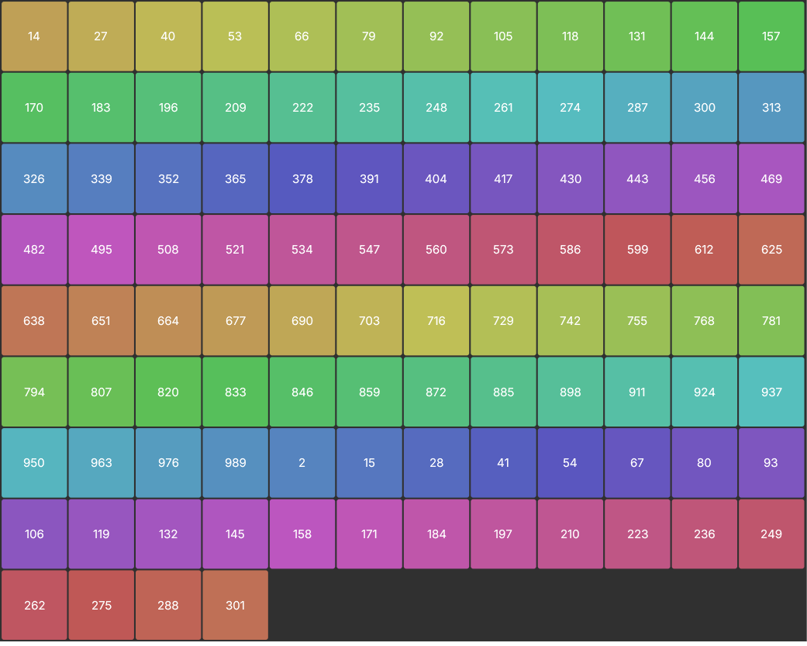
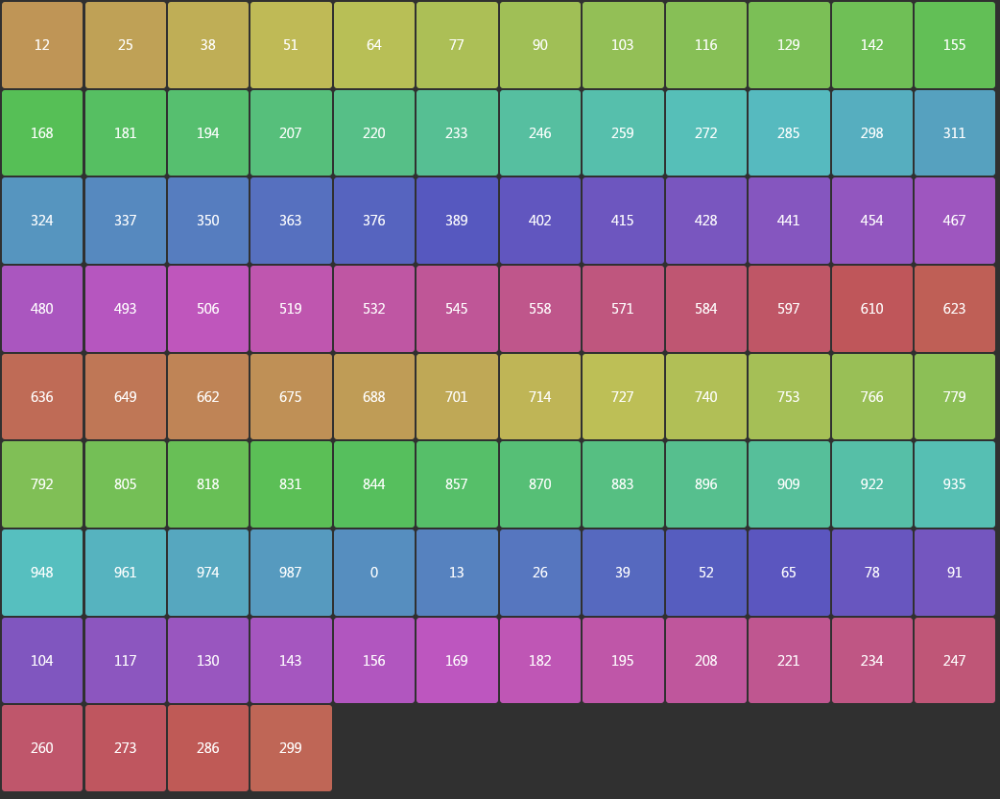
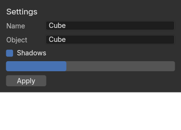
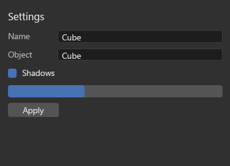

# BUI vs GPUI — a measured comparison

Two GUI frameworks, two example apps, one measurement harness. This repository
answers a narrow, testable question: **for the same UI, which framework costs
less machine — CPU per frame, GPU time, memory, and time to first frame?**

| | [BUI (`blenderui`)](https://github.com/ppmpreetham/BUI) | [GPUI](https://github.com/zed-industries/zed/tree/main/crates/gpui) |
|---|---|---|
| What it is | Blender's UI toolkit, extracted from Blender: a C core with thin Rust bindings | Zed's UI framework: pure Rust, GPU-rendered |
| Rendering | software raster (default) **or** GPU (OpenGL 3.3 / D3D 11) | always GPU (Vulkan / Metal / D3D) |
| Widgets | Blender's real widgets — number fields, sliders, colour picker, pie menus, node editor | primitives only — you build controls from `div`s |
| Version measured | `blenderui` **0.5.0** | `gpui` **0.2.2** |

Both are driven through gpui's own builder API (`div().flex().gap_2()`), because
BUI implements that syntax. That is what makes the comparison controlled: **one
source file compiles against both frameworks.**

## The two examples

**1. Grid scene — throughput.** A full-window flex container of N rounded cells,
each with a centred number. Three modes: `anim` (every cell changes each frame),
`one` (only the first changes — what a hover or clock really does), `idle`
(nothing changes). Swept at 100 / 1000 / 3000 cells, paced and uncapped.

| BUI, CPU raster | BUI, GPU renderer | gpui |
|---|---|---|
|  |  |  |

**2. Settings form — fixed costs.** A 360×260 tool window that renders twice and
stops. It measures what a window costs when it is *not* animating: start-up,
memory, idle CPU. gpui has no form widgets, so both sides use styled `div`s; a
third crate draws the same form with BUI's real Blender widgets.

| BUI (divs) | gpui (divs) |
|---|---|
|  |  |

## The results

Cost of one frame with **CPU and GPU added together** — the only fair comparison,
since each framework can look cheap by pushing work to the other half of the
machine. Every cell animating, medians of 5 runs:

| Cells | BUI, CPU raster | BUI, GPU renderer | gpui |
|---:|---:|---:|---:|
| 100 | **2.73 ms** | 10.48 ms | 4.12 ms |
| 1000 | **7.16 ms** | 23.97 ms | 13.20 ms |
| 3000 | **15.13 ms** | 38.61 ms | 40.19 ms |

| | BUI, CPU raster | BUI, GPU renderer | gpui |
|---|---|---|---|
| CPU per frame (1000 cells) | 7.16 ms | **2.85 ms** | 11.17 ms |
| GPU per frame (1000 cells) | none used | 21.12 ms | **2.03 ms** |
| Resident memory (1000 cells) | **24 MB** | 90 MB | 102 MB |
| Time to first frame | **1.5 ms** | 1.5 ms | 54–72 ms |
| Idle CPU | **0.10 %** | 0.10 % | 0.30 % |

## What that means

**There is no single faster framework — there are three designs that win on
different resources.**

- **BUI's software raster is the cheapest in total, everywhere.** No GPU at all,
  4.2x less memory than gpui, and about 38x faster to first frame (median 1.5 ms against 56.8 ms). It is the clear
  choice for tool windows, dialogs and low-end machines. Its weakness is that on
  Linux it rasterizes **single-threaded** (the parallel band renderer is
  `#ifdef _WIN32`), so its frame rate falls away as scenes grow.
- **BUI's GPU renderer wins CPU by 3.9x but spends 10x more GPU time.** In total
  it is usually *more* expensive than gpui. It frees the CPU; it does not save
  the machine. Turn it on for large, continuously animated surfaces, not by
  default.
- **gpui is the most balanced** and holds 60 fps longest, because it spreads work
  across both CPU and GPU and its GPU side is nearly free. It pays in fixed
  costs: a Vulkan device and cosmic-text mean ~90–130 MB and 53–76 ms before
  anything appears.

Two numbers worth remembering. For a small tool window, **BUI: 10 MB and 1.5 ms;
gpui: 87 MB and 59 ms** — for identical pixels. And at 1000 cells all three look
close on screen (41–59 fps) while costing 7.2–24.0 ms of machine per frame,
which is why this harness reports milliseconds and not just frame rate.

📄 **[COMPARISON.md](COMPARISON.md)** has the complete analysis: every table,
every mode, scaling curves, memory growth, why the differences exist, threats to
validity, and the verdict matrix.
📊 **[RESULTS.md](RESULTS.md)** is the raw generated report from the last sweep.
♻️ **[REUSING.md](REUSING.md)** — how to lift out the measurement library, the
scenes or the harness for your own framework.
📚 **[DOCS-COMPARED.md](DOCS-COMPARED.md)** — how the two projects document
themselves, measured: 4,354 against 199 lines of prose, and what each set does
better.

## Reproducing it

```sh
cargo build --release      # both frameworks, both examples (~5 min cold)
python3 bench/verify.py    # ~1 min: sanity-check the harness before trusting it
python3 bench/run.py       # full sweep (~47 min), writes RESULTS.md
```

Single experiments, each printing one JSON line:

```sh
./target/release/grid-scene-bui  --cells 1000 --mode anim          # CPU raster
./target/release/grid-scene-bui  --cells 1000 --mode anim --gpu    # GPU renderer
./target/release/grid-scene-gpui --cells 1000 --mode anim
./target/release/settings-form-gpui --seconds 10
```

Requirements: Rust 1.99+, CMake 3.20+, a C compiler, X11 headers. On glibc Linux
gpui needs two small accommodations, both already wired up here — a patched
`xattr` crate and, if your distro ships no `libxkbcommon-dev`, a link stub
(`sh third_party/stubs/make-stubs.sh`). See
[COMPARISON.md §9](COMPARISON.md#9-known-issues-encountered).

## Why these numbers are trustworthy

Every metric is taken **inside each process** by the same `bench-common` code
that both frameworks link — the frameworks are never involved in measuring
themselves.

- **Same compiler settings** for both: opt-level 3, thin LTO, 1 codegen unit, stripped.
- **Same scene source**, compiled twice — literally the same lines.
- **Same window**: BUI's `<body>` margin is zeroed so its flex container fills
  the window exactly like gpui's root `div`.
- **Nothing re-parsed per frame**: the grid is computed once at start-up.
- **GPU time from the kernel's per-process DRM counters**, cross-checked by hand
  (55 fps × 10.7 ms = 59 % GPU busy matched an independent 55–60 % sample).
- **Interleaved runs**: BUI, BUI-GPU and gpui back to back within each
  repetition, so desktop load drift hits all three equally.
- **Stalled runs are rejected, not averaged.** A Wayland compositor withholds
  frame callbacks from occluded windows, which made gpui render 0 fps for whole
  windows. Both frameworks are pinned to X11 and any run under 0.5 fps is retried
  then dropped.
- **`bench/verify.py`** checks each of the above mechanically and fails loudly.

## Layout

```
bench-common/            scene parameters + the measurement (no framework code)
bench/run.py             drives every binary, writes results.json and RESULTS.md
bench/verify.py          sanity checks: is each column measuring what it claims?
bench/shots.py           screenshots of each example (docs/shots/)
bench/machine.sh         CPU, GPU, display and toolchain of this machine
examples/01-grid-scene/  scene.rs shared; bui/ and gpui/ crates
examples/02-settings-form/  form.rs shared; bui/, bui-native/ and gpui/ crates
third_party/xattr/       gpui's xattr 0.2.3 with one libc constant fixed for Linux
COMPARISON.md            the full analysis
RESULTS.md               generated tables from the last sweep
REUSING.md               how to reuse the harness, scenes or measurement code
DOCS-COMPARED.md         how the two projects document themselves, measured
```

## Caveats in one breath

One machine (Intel i5-1135G7, Iris Xe iGPU, `powersave` governor), one session,
with the user's IDE and browser running. Absolute numbers will not transfer;
**the ratios are the result**. BUI's GPU renderer is OpenGL 3.3 on Linux, gpui's
is Vulkan — different APIs on the same GPU. Frame rates saturate at the 60 Hz
display. Re-run on your own machine: that is what the harness is for.
